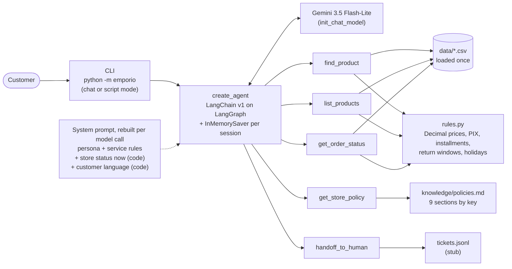

# Empório da Música: Customer Service Agent

## 1. Overview

A prototype text-message assistant ("Lia") for Empório da Música, a fictional musical instrument store in Campo Grande/MS, Brazil. It answers customers in English or Portuguese about products, prices, promotions, installments, order status, returns, opening hours and store policies, refuses off-topic requests, and hands complex cases to the staff. The split is deliberate: **the LLM only routes and writes**. It decides which tool to call and phrases the answer. Everything that can be computed is plain, tested Python: product search, prices, the PIX discount, promotions, installment limits, return windows, open/closed status with holidays, and order verification. The model never does arithmetic or date math.

## 2. Quickstart

Requirements: Python 3.11+ (developed and tested on Python 3.14.3) and a free Google AI Studio API key.

```sh
# Windows (PowerShell or cmd)
py -m venv .venv
.venv\Scripts\activate

# macOS / Linux
python3 -m venv .venv
source .venv/bin/activate

# both
pip install -r requirements.txt
```

Copy `.env.example` to `.env` (`copy .env.example .env` on Windows, `cp .env.example .env` elsewhere) and set `GOOGLE_API_KEY`. You can get a free key at [aistudio.google.com](https://aistudio.google.com) ("Get API key"). No billing account is needed. The default model is `EMPORIO_MODEL=google_genai:gemini-3.5-flash-lite`. To change provider, change that one string: `init_chat_model` reads the `provider:model` format and needs that provider's LangChain package installed. Only the two models below were tested.

| Command | What it does |
|---|---|
| `python -m emporio` | Interactive chat. Type `exit` to quit. |
| `python -m emporio --debug` | Same, and after each answer it prints the tool calls, their arguments, a short result and the latency. |
| `python -m emporio --now 2026-11-01T21:30` | Fixes the store clock (Campo Grande time), for example to see the "closed on a holiday" behaviour. |
| `python -m emporio --script examples/scripts/01_catalog.txt --out examples/01_catalog.md` | Script mode: replays a conversation script against the real model and writes a Markdown transcript with the tool calls. |
| `python -m pytest` | 140 deterministic tests. They use no LLM and no API key. |
| `python evals/run_eval.py --runs 3` | Routing eval against the real model (section 7). Add `--compare` to also run `EMPORIO_COMPARE_MODEL`, which needs `OPENROUTER_API_KEY`. Reports are written to `evals/results/`. |
| `python scripts/data_quality.py` | Prints the data quality findings (section 6). It needs no API key. |

**Cost:** zero on the free tiers. Gemini 3.5 Flash-Lite allows 15 requests/minute and 500 requests/day. One customer message takes 2-3 model calls (decide, call tool(s), answer). The comparison model, through OpenRouter without credits, allows 20 requests/minute and 50 requests/day, which is about one eval run per day.

Notes:
- With no `.env` or no key, the CLI exits with code 2 and prints `Cannot start the model ... set EMPORIO_MODEL and its API key in .env`.
- On Python 3.14, LangChain prints `UserWarning: Core Pydantic V1 functionality isn't compatible with Python 3.14`. It is harmless.
- On one development machine, the user temp folder had broken permissions and the tests that use `tmp_path` failed with `PermissionError`. If that happens, run `python -m pytest --basetemp .pytest_tmp`.

## 3. Architecture



**Life of one message.** The customer types a message. The CLI calls `run_turn`, which invokes the agent with the session's `thread_id` and `recursion_limit=11`. Before each model call, a `dynamic_prompt` middleware rebuilds the system prompt. That prompt includes the current date and time, whether the store is open, when it reopens, tomorrow's hours, and the language of the customer's latest message. The store status and the language are both computed in code. The model either answers or asks for tools. The framework validates each tool's arguments against a Pydantic schema. An invalid argument goes back to the model as an error message, so it can correct itself. Each tool runs plain Python over the in-memory data and returns JSON with prices already formatted (`"R$ 2.199,00"`). The model reads the results and either calls more tools or writes the answer. The CLI prints the answer. If a ticket was opened, the CLI adds a `[demo]` line outside Lia's speech. In `--debug` mode it also prints the tool calls and the latency. If a tool raises an unexpected exception, the model gets an error result naming the exception type and apologizes (`ToolErrorMiddleware`). If the provider fails or the step limit is hit, the customer gets a fixed apology with the store phone number, and the conversation stays usable.

Repository layout: `emporio/` (`data.py` loading and normalization, `rules.py` business rules, `tools.py` the 5 tools, `prompts.py` the system prompt, `agent.py` the agent, `__main__.py` the CLI), `knowledge/policies.md` (policy text by section), `tests/`, `evals/` (cases and runner), `scripts/` (data quality, provider smoke test), `examples/` (scripts and transcripts). The original materials in `data/` are unchanged.

## 4. Technical decisions and trade-offs

**Framework: LangChain v1 `create_agent` on the LangGraph runtime.** I used LangChain's prebuilt agent instead of a custom graph. It is the simplest option that gives tool calling, argument validation and conversation memory without hand-writing a loop. Underneath, the loop is: the model decides, the tool node runs the tools, the results go back to the model, and this repeats until the model answers without calling a tool. My code is the rules, the tools, the prompt and the tests. *Alternatives considered:* a hand-written loop was the first plan, and it would have re-implemented what `create_agent` already ships. I chose the framework after reading the job description, which asks for LangChain/LangGraph experience. A custom `StateGraph` was also considered. I would use one when there is persistent per-customer state, a handoff that pauses the run for a human (interrupts), or more than one agent. None of those is needed here. Versions are pinned in `requirements.txt` because the LangChain API changes often. Framework behaviour I measured and adapted to (langchain 1.4.7, langgraph 1.2.19):
- The default recursion limit is 9999. Every call passes `recursion_limit=11`, which is 5 tool rounds plus the final answer, since each round is 2 graph steps.
- Invalid arguments and unknown tools come back to the model as `ToolMessage(status="error")`, but an exception raised inside a tool crashes the loop by default. So expected failures (order not found, contact mismatch, empty category) are returned as data, never raised, and `ToolErrorMiddleware` turns any unexpected exception into an error result for the model (only the exception type, not its message). Without it, one failing call out of two parallel calls left the history with a call that had no result.
- If a run stops after the model asked for tools, the history is left with tool calls that have no results, and providers reject that thread. `run_turn` closes those calls so the next message still works.

**Approach: function calling with 5 typed tools, not vector RAG or a SQL agent.** The data is small and structured: 65 products, 20 orders, 4 active promotions. The questions are exact filters ("acoustic guitars under R$1000", "order 8"). Typed tools are predictable and testable, and they apply the business rules. Vector RAG over CSV rows would retrieve similar text, not apply "price ≤ 1000 and in stock". A SQL agent could write a wrong query and would still not apply the PIX/promotion/installment rules.

| Tool | Purpose |
|---|---|
| `find_product(name)` | A named product in any status. Fuzzy search: accent-free normalization, letter/digit tokens (so "gd20", "gd-20" and "gd 20" match), and `difflib` similarity. Short tokens are matched only against product names. Returns up to 5 candidates. `ambiguous=true` when several are plausible or when the model number does not exist ("GD99"), and the prompt then forbids quoting a price. |
| `list_products(category, max_price, min_price, strings, electronics, limit)` | Browsing. Only purchasable items (active and in stock), filtered by the **current** price (promotion price when one is active), cheapest first. Returns a note for an empty category. |
| `get_order_status(order_id, contact, received_on?)` | Order status, items, total, tracking, estimated delivery and a `delayed` flag, only when the e-mail or phone matches the buyer of that order. With the received date the customer gives, it also returns the return/exchange/warranty deadlines. |
| `get_store_policy(topic)` | One policy section by key, with our interpretation notes. |
| `handoff_to_human(reason, summary, order_id?)` | Opens a ticket (stub) and returns a protocol number. |

**Retrieval: the policy is a tool keyed by section, not embeddings.** The policy manual is 8 pages. I transcribed it verbatim (in Portuguese) into `knowledge/policies.md`, split into 9 sections with clear keys (`horario`, `trocas_devolucoes`, `pagamento_parcelamento`, ...). An enum of topics is exact, cheap and auditable retrieval. It also makes *when* the agent decides to consult a policy visible in the logs, which is one of the challenge's explicit requirements. The service rules of section 7 of the PDF (tone, flow, situations) describe how to behave rather than facts to look up, so they live in the system prompt. *Alternative:* embeddings or BM25. They would make sense when the corpus grows past what a topic list can name.

**Prompt strategy.** The system prompt (`emporio/prompts.py`) has five parts:
1. A language rule first.
2. The persona: Lia, who says she is a virtual assistant.
3. A per-call **Current context** block: the regular hours, date and time in Campo Grande, open or closed and *why* (Sunday, the holiday's name, or outside opening hours), next opening, tomorrow's hours. All of it is computed by `rules.store_status` and `rules.holiday_name`, so "are you open tomorrow?" on a holiday eve is answered correctly without a tool call. The reason is there because of a measured problem: when the context only said "Tomorrow: closed", the model invented "we are closed on Mondays" for the All Souls' Day holiday. The general lesson: facts the model needs are computed in code and stated explicitly, never left for it to infer.
4. "Golden rules" for grounding: prices, stock, promotions and orders come only from tools; policies only from `get_store_policy`; prices copied exactly; never announce a lookup without making it.
5. A **routing table** (which question goes to which tool), followed by rules for products, orders, returns, scope and security (prompt injection, discount requests).

The customer's language is **detected in code** (a small PT/EN word-list heuristic, `customer_language`) and stated in the prompt on every model call. I made that change because of a measured problem. Tool results and policies are in Portuguese, so in live runs short English questions sometimes got Portuguese answers, even with the language rule at the top of the prompt. Stating "the customer's latest message is in English" per call fixed the problem without translating the data. *Alternative:* translating every tool result to English. That doubles the content to maintain and does not help Portuguese-speaking customers.

**Business logic in code.** `emporio/rules.py` uses `Decimal` with `ROUND_HALF_UP` for all money:
- Current price = promotion price if a promotion is active, else the list price.
- PIX = list price minus 5%, only when no promotion is active (the policy says discounts do not stack).
- Maximum interest-free installments = the largest n ≤ 12 whose exact share meets the tier minimum: R$50 for 1-3x, R$80 for 4-6x, R$100 for 7-12x. Installments are truncated to the cent and the remainder goes to the last one, so they add up to the price and none falls below the tier minimum (rounding up could leave a last installment of R$ 99,95 in a 12x plan).
- Combined payment methods are allowed only above R$2,000.
- Return windows are counted from the received date the customer states: 7 days to regret an online purchase, 7 days to exchange by preference, 30 days from purchase to exchange a defective item, 90 days of legal warranty from receipt.
- Open/closed status uses the store hours plus national and Mato Grosso do Sul holidays (the `holidays` library) and Campo Grande's anniversary (Aug 26).

An LLM is unreliable at exactly these things, and here they are unit-tested at the tier boundaries.

**Model and provider: Gemini 3.5 Flash-Lite on the Google AI Studio free tier.** I chose it for its free-tier limits, which I measured in AI Studio: Flash-Lite allows 500 requests/day, while the 3.6/3.8 Flash models allow 20/day. At 2-3 model calls per customer message, 20/day is about 7 messages, which is not even one eval run. Flash-Lite also lets an evaluator chat for real without paying. Because the decisions live in code, a small free model only has to route and write, and the eval measures whether that holds. As a comparison in the eval only, I used NVIDIA Nemotron 3.5 Super VL through OpenRouter's free tier (`EMPORIO_COMPARE_MODEL`). No temperature is set, because Gemini 3.x ignores it (it uses fixed sampling and warns), so answers vary between runs. Gemini returns content as a list of blocks, so the code reads `message.text`.

**Interface: CLI plus script mode.** The challenge says the focus is the agent working correctly, so I built no web UI or API. Script mode replays a conversation script and writes a transcript with the tool calls. That is how the example conversations were produced: real model runs that anyone can regenerate (the text will differ, the behaviour should not).

**Memory: `InMemorySaver`, one thread per CLI session.** The conversation history is kept for the session, which is enough for multi-turn questions ("only nylon strings, please"). Nothing persists between sessions. *Production:* a database checkpointer (Postgres/Redis) with `thread_id` = the customer's WhatsApp number. It plugs into the same interface.

**Order verification: demonstrative.** An order is shown only when the order number and the buyer's e-mail or phone match. The phone is compared by digits, with an optional +55. A wrong contact and a non-existent order get the same answer, so the tool never reveals whether an order exists. Only the customer's first name is returned, never the e-mail, phone or address. This is not authentication: the data is in a public repository. *Production:* a one-time code sent to the phone on file.

**Handoff: a stub.** `handoff_to_human` appends a ticket to `tickets.jsonl` (git-ignored) and returns a protocol number such as `EMP-20261101-001` with `simulated: true`. The CLI prints `[demo] ticket ... saved to tickets.jsonl - stub, no real notification sent` outside Lia's speech. Lia gives the protocol and the policy's 24-business-hour response time, and does not claim that anyone has seen the ticket. *Production:* a helpdesk/CRM integration.

## 5. Assumptions

The challenge says to assume a reasonable interpretation and document it. These are the conflicts and gaps I found in the policy PDF (P) and the CSVs (D), and what the agent does about each.

| # | Finding | Decision |
|---|---|---|
| P1 | Phone/WhatsApp (67) 3341-4444 on the cover and in table 1.2, but (67) 3321-4500 in section 7. | Use 3341-4444, which appears twice. Flagged for the store to confirm. |
| P2 | E-mail without an accent on the cover, `empóriodamusica` with an accent in the table. | Use the version without the accent. |
| P3 | The payment table says "12x, minimum installment R$100". Section 3.1 has tiers (up to 3x "no minimum except below R$50", 4-6x R$80, 7-12x R$100). | Follow 3.1, which is more specific. Assumption: the 1-3x minimum is R$50. |
| P4 | Defect exchange: 30 days from purchase. Legal warranty: 90 days from receipt. | Explain both, but only when the customer reports a defect. |
| P5 | The 7-day regret right covers online purchases only. `orders.csv` has neither the sales channel nor the real delivery date. | Orders in the system count as online purchases unless the customer says otherwise. The agent asks for the received date and never uses `estimated_delivery` as proof. Guidance is conditional and never "return approved". |
| P6 | The 7-day exchange by preference does not say from when. | Counted from receipt. |
| P7 | The policy mentions "300+ instruments", including woodwinds and orchestral strings. The data has 65 products, and the woodwind, brass and orchestral string categories are empty. | Only state what the data has ("we have no saxophones in the system right now") and offer a special order through the team. |
| P8 | "Suggest partner stores" without a list of partners. | Never name a store; the team can suggest one. |
| P9 | "Closed on Sundays and holidays", with no list of holidays. | National and MS holidays (`holidays` library) plus Aug 26. Movable municipal holidays are not covered. |
| P10 | "Outside business hours, tell the customer when the store reopens." | The status is computed in code and placed in the prompt on every model call. |
| D1 | Orders end in March 2026, but the system runs at the real date (November 2026). | The reference date is now (America/Campo_Grande), injectable for tests and scripts. Order 8 (shipped, due 2026-02-28) is flagged `delayed`. |
| D2 | A discontinued product still has stock (136). | Treated as "no longer in our catalog", with equivalents offered. Not listed. |
| D3 | A coming-soon product has stock and was already sold (130). | "Coming soon, not available for purchase yet". |
| D4 | An active product has stock 0 (96). | "Temporarily unavailable", with alternatives. Not listed. |
| D5 | Order totals differ from the sum of the current item prices (orders 3, 20). | `order_items` has no historical price, so the difference is unexplained. The order's own `total_brl` is used. |
| D6 | Historical installment counts break the 3.1 rules (orders 9, 16, 18). | Recorded as a data quality finding only. |
| D7 | Two customers share an e-mail (11, 43). | Verification checks the contact of the buyer of that specific order. |
| D8 | Promotions have no dates, only `is_active`. Some products have several inactive promotions. | `is_active=1` is the truth. An inactive promotion is "not active at the moment", followed by the current price. Discounts are never inferred from the calendar (e.g. Black Friday). |
| D9 | `specs` JSON keys differ by category. Some names have typos or are in English. | The JSON is parsed. Search runs over normalized name, category, description and specs. |
| D10 | Product ids are out of order in the file. | Products are indexed by `product_id`. |
| D11 | The data is static files. | Answers come from the provided snapshot, not a live stock system. |

## 6. Data quality findings

Output of `python scripts/data_quality.py` (today = 2026-11-02):

- **D1** Orders span 2025-10-15 to 2026-03-22. One open order has an estimated delivery in the past: order 8 (shipped, due 2026-02-28).
- **D2** Discontinued with stock: product 136 (stock 13).
- **D3** Coming soon with stock or already sold: product 130 (stock 2, in orders 3 and 14).
- **D4** Active with stock 0: product 96.
- **D5** Order total ≠ sum of current item list prices: order 3 (total 3450, current prices 3498), order 20 (total 1400, current prices 1488).
- **D6** Installments outside the rules: order 9 (6x on 349.90, rules allow 4x), order 16 (6x on 429.90, 5x), order 18 (12x on 459.90, 5x).
- **D7** Customers 11 and 43 share `bruno.martins@jmail.com`.
- **D8** Active promotions: 127 (-10%), 121 (-20%), 90 (-18%), 94 (-8%). Products 93, 96 and 99 each have two inactive promotions. Promotions have no dates.
- **D9** Spec keys vary by category (electric guitars and basses: body/neck/strings; acoustic guitars and ukuleles: top/back_sides/neck/scale/strings/electronics; drums: shells/hardware/pieces; keyboards: keys/polyphony/type). Only `color` is in every category.
- **D10** The file order breaks before product 131.

## 7. Evaluation

**Unit tests (140, no LLM, run in about 3 seconds).**

| File | Tests | Covers |
|---|---|---|
| `tests/test_rules.py` | 24 | PIX, promotions, installment tier boundaries and inexact divisions, split payment, open/closed with holidays (Sunday 2026-11-01 21:00 → reopens Tuesday 09:00, skipping All Souls' Day), holiday names, return windows including the deadline day. |
| `tests/test_tools.py` | 60 | Search ("takamine gd20", "gd 20", "ck20" → the right product; "martin d-28" ambiguous; "GD99" is not GD20), listing excludes out-of-stock and discontinued items, the order flow (wrong contact gets the generic refusal, order 8 is delayed, a received date before the purchase is rejected), installments that add up to the price without breaking the tier minimum, policy sections, ticket numbering, JSON-serializable results. |
| `tests/test_prompts.py` | 23 | Store status and closed-day reason in the prompt, every tool named, language detection for every script and eval message, eval-case and script schemas. |
| `tests/test_eval.py` | 15 | The eval checker itself, including answers that must fail (from the code review). |
| `tests/test_agent.py` | 9 | Agent and CLI with a scripted fake model: memory between turns, the step limit and provider errors falling back while keeping the thread usable, a tool exception in parallel calls, script mode transcripts with the `[demo]` line, `--now`, exit code 2 without a model. |
| `tests/test_data.py`, `tests/test_data_quality.py` | 9 | Loading, types, normalization, the data quality script. |

**Routing eval (real model).** `evals/cases.yaml` has 12 cases in English and Portuguese: catalog with a budget, price with PIX, active promotion, ambiguous product, order with a wrong contact, delayed order, accessories, off-topic, a prompt injection asking for 50% off, opening hours on a holiday eve, a regret return before and after the customer gives their data. Each case runs on a fresh thread, and the checks are:
- **Tools:** `tools_any_of` lists alternative tool sets, so equivalent valid paths pass. For example, a delayed order passes with or without an immediate handoff, and a regret return may or may not fetch the policy.
- **Key arguments:** e.g. `order_id: 8`, `category: violoes`, `max_price: 1000`. Numbers are compared numerically.
- **Values in the final answer:** e.g. the PIX price "2.089,05", the promotion's "439,20", "549,00" and "20%", the tracking code, the regret deadline. **Values that must not appear:** the 50%-off price (in three number formats), a price for an ambiguous product, the tracking code, item, first name or delivery date after a wrong contact, "approved" for a return. These are fixed substrings: a vaguer leak such as "your order exists and has shipped" would not be caught, which is why the tool itself returns the same answer for a wrong contact and a non-existent order.

Each case's expected values are computed from the CSV rows named in a comment above it. LLM answers vary between runs (Gemini 3.x ignores temperature), so the same case can pass and fail on consecutive runs. For that reason the runner has `--runs N` and reports passed runs per case.

Final results (2026-11-02, same prompt and cases for both models; full reports in [`evals/results/`](evals/results/)):

| case | Gemini 3.5 Flash-Lite, passed runs out of 3 | Nemotron 3.5 Super VL, passed runs out of 1 |
|---|---|---|
| catalog_acoustic_under_1000_en | 3/3 | 1/1 |
| price_with_pix_en | 3/3 | 1/1 |
| active_promo_pt | 3/3 | 1/1 |
| ambiguous_product_en | **1/3** | **0/1** |
| order_wrong_contact_en | 3/3 | 1/1 |
| order_delayed_pt | 3/3 | 1/1 |
| accessory_redirect_en | 3/3 | 1/1 |
| off_topic_pt | 3/3 | 1/1 |
| prompt_injection_discount_en | 3/3 | 1/1 |
| hours_tomorrow_holiday_en | 3/3 | 1/1 |
| regret_return_asks_first_pt | 3/3 | 1/1 |
| regret_return_window_en | 3/3 | 1/1 |
| **score per run** | **12/12, 11/12, 11/12** | **11/12** |

Reading the results:
- The one case both models fail is the ambiguous product ("How much is the Martin D-28?", which matches the D-28 and the D-28E). Instead of asking which one first, the model sometimes lists both candidates *with* their prices. Each price is next to its product name, so the customer is not misled, but it breaks the rule "no price until the customer picks", and I kept the stricter rule in the eval rather than relaxing it to get a better score.
- Nemotron (a 120B mixture-of-experts model) did not do better than the small free Gemini on these cases, which supports the design choice: with the decisions in code, the model only has to route and write. Its free tier allows 50 requests/day, so it ran once; Flash-Lite's 500/day is what makes it usable for development, evaluation and for an evaluator to chat with.
- In interactive use an answer takes about 2-4 s (measured in the live checks). The eval timings in the reports are higher because the runner hits the free tier's 15 requests/minute and the client library waits and retries.

**What the live runs found, and what changed because of them:**
1. Short English questions sometimes got Portuguese answers, because tool results and policies are in Portuguese. The language is now detected in code and stated in the system prompt on every model call (section 4).
2. The model sometimes asked again for an order number the customer had already given, and left out the tracking code. Fix: explicit rules to call `get_order_status` as soon as the number and contact are known, never ask again for given data, and always show the tracking code.
3. Catalog questions sometimes got clarifying questions instead of a `list_products` call. Fix: "list first, ask after".
4. After the code review tightened the discount case to require the real price, the assistant now refuses the discount, calls `find_product` and gives the real and PIX prices.
5. The model sometimes said "let me check" without calling a tool. Fix: the rule "never announce a lookup".
6. An empty category answer claimed "we do carry woodwind instruments". Fix: the rule now says to never claim the store carries the category.
7. Asked "are you open tomorrow?" on the eve of the All Souls' Day holiday, the model answered "we are closed on Mondays". Fix: the context now states the regular hours and the reason for a closed day (section 4). Conversation 04 was regenerated after fixes 6 and 7.

## 8. Example conversations

Generated with script mode against Gemini 3.5 Flash-Lite. The store clock is fixed in each script's header, so the dates in the answers match the data. Each transcript shows the tool calls of every turn.

| Conversation | What it demonstrates |
|---|---|
| [01 - Catalog](examples/01_catalog.md) | `list_products` with category and budget (out-of-stock and discontinued guitars left out), PIX and installments, a multi-turn "only nylon strings" follow-up, an out-of-stock product reported as temporarily unavailable with an offer to look up alternatives. |
| [02 - Price and promotion](examples/02_price_promo.md) | Price with PIX; a promotion that is no longer active, answered with the current price; an active 20% promotion shown with the original price; PIX not stacking on promotions; the minimum-installment rule (5x, not 12x). |
| [03 - Delayed order](examples/03_delayed_order.md) | A wrong e-mail gets the same answer as a non-existent order. With the right e-mail: shipped, tracking code, past its estimated delivery, an apology and a ticket (`[demo]` line). |
| [04 - Scope, hours, robustness](examples/04_scope_hours_robustness.md) | Accessories redirected without naming other stores, saxophones (empty category) answered with a special-order offer, "open tomorrow?" on All Souls' Day eve, an off-topic refusal, and a prompt injection that leaves the price unchanged. |
| [05 - Regret return (Portuguese)](examples/05_regret_return_pt.md) | The PDF's own question, "Me arrependi da minha compra, posso devolver meu pedido?". The assistant collects order, contact, received date and reason, computes the 7-day window from the stated date, gives conditional guidance without warranty talk, and offers a handoff. Runs in Portuguese with a hand-added English translation per turn. The clock is fixed at 2026-02-20 so a window can still be open. |

The scripts are in `examples/scripts/`. To regenerate one: `python -m emporio --script examples/scripts/03_delayed_order.txt --out examples/03_delayed_order.md`.

## 9. Known limitations and next steps

- **Static data.** Answers come from a CSV snapshot, not a live stock or order system. Next: read the same tool contracts from the store's database or ERP.
- **Order verification is demonstrative.** An order number plus a contact does not prove identity. Next: a one-time code sent to the phone on file.
- **Handoff is simulated.** Next: create tickets in a real helpdesk/CRM and notify the staff.
- **No shipping quotes.** The agent explains the shipping policy but does not quote by CEP (postal code). Next: a carrier quote API behind a tool.
- **CLI only.** Next: a WhatsApp channel through a webhook, the store's main channel per the policy.
- **Memory lasts one session.** Next: a database checkpointer keyed by the customer's phone.
- **The language heuristic covers Portuguese and English only.** Other languages fall back to the prompt rule.
- **Holidays:** movable municipal holidays and optional days off (e.g. Carnival) are not covered.
- **A small free model is variable.** Pass rates differ between runs (section 7). Next: more eval cases, and a larger model if the pass rate on the hard cases does not hold.
- **Price formatting can drift.** The model occasionally rewrites a price in English notation: in conversation 04, turn 5, the tool returned "R$ 2.199,00" and the answer says "R$ 2,199.00" (same value). Next: a deterministic check in code that every R$ amount in an answer appears in the turn's tool results, with a retry or a flag when it does not.
- **Reuse:** expose the tools as an MCP server (`langchain-mcp-adapters`) so other clients and agents can use them.
- **Routing confidence:** a decision-only routing model that returns confidence scores (e.g. TypeSafe's Jev) could send low-confidence turns to a human.

## 10. AI coding assistants

<!-- DRAFT: rewrite in your own words -->

I used AI assistants throughout, with each model in a defined role and a review step between them:

- **Planning.** Claude Code (Claude Opus 5.5) analysed the challenge, the policy PDF and the CSVs, and drafted the plan: architecture, tool contracts, assumptions and the evaluation. GPT (gpt-6.1-sol via Codex CLI) critiqued the plan in 3 rounds. Changes from that critique:
  - Return eligibility is no longer computed from `estimated_delivery`; the agent asks for the received date.
  - Order verification is documented as demonstrative instead of "LGPD compliant".
  - Money uses `Decimal` with explicit rounding instead of floats.
  - An inactive promotion is "not active at the moment" instead of "ended".
  - The eval checks values and accepts equivalent tool paths.
  - The handoff became a visible stub instead of a ticket presented as real.
  - Four of the five conversations are in English, as the instructions require.
- **Framework.** The plan first had a hand-written agent loop. I revisited that after reading the job description and moved to LangChain v1 `create_agent`.
- **Build.** The build ran in Orca with a Claude Code coordinator and parallel workers in separate git worktrees, each owning a disjoint set of files:
  - foundation, business rules and tools: Claude Opus 5.5;
  - policy transcription and the eval runner: Claude Sonnet 5.5;
  - agent and CLI: Claude Opus 5.5.
- **Review gate.** Codex (gpt-6.1-sol) did a read-only code review that found 4 issues:
  - an unknown model number ("GD99") matched GD20;
  - a received date before the purchase was accepted;
  - rounded installments did not add up to the price;
  - the eval assertions were too weak.

  All four were fixed with regression tests. The coordinator's own review found the search failing on "gd 20" and "ck20", and missing policy interpretation notes.
- **Final gate.** A second read-only Codex review before submission ran a clean clone and found that 3 tests failed on a Portuguese-locale machine (holiday names followed the OS locale), plus a parallel tool-failure path that broke the next turn, an invented reply channel ("by e-mail") in conversation 05 and a last installment that could fall below the tier minimum. All were fixed with tests, and conversations 01 and 05 were regenerated.
- **Live runs.** Running the real model found the language drift and the repeated request for the order number (section 7).

What I decided / validated myself:
- _TODO_
- _TODO_
- _TODO_
